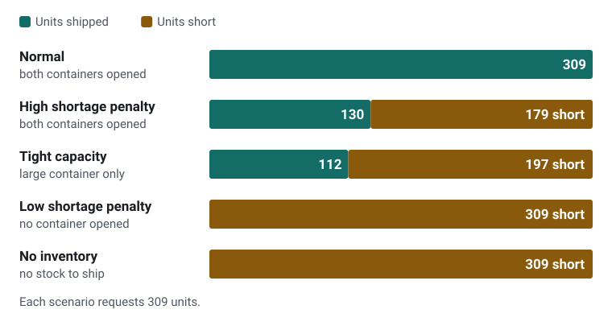

# Inventory and Shipping Optimization Lab

**Decides which containers are worth opening when shipping every unit isn’t, and re-checks every plan independently.**

[Read the case study](https://h-yang-26.github.io/projects/inventory-shipping-optimization-lab/) · [How this was built](#how-this-was-built) · [Portfolio](https://h-yang-26.github.io/)

<picture>
  <source media="(prefers-color-scheme: dark)" srcset="docs/scenario-results-dark.svg">
  
</picture>

*Results from the five fictional scenarios in `results/example_results.json`. Costs are in made-up units, not real freight rates. Figure from the portfolio site.*

A small, original Python demonstration: allocate a few **fictional** products to one or two
**fictional** shipping containers under supply, demand, mass and volume limits, using an integer
program solved with PuLP + CBC. It shows how the model trades **unfulfilled demand** against
**fixed container charges**.

> **Limitation (read first).** This is a mass/volume *feasibility* model only. It is **not** a
> validated 3D container-loading, stacking, weight-distribution, or load-restraint plan. A plan
> with 100 % volume utilization can still be physically impossible to pack. All quantities and
> costs are invented, in `toy_cost_units`; nothing here reflects real freight rates, equipment,
> or business results.

## Quick start (Windows PowerShell, Python 3.11+)

```powershell
py -3.11 -m venv .venv            # or: python -m venv .venv
.\.venv\Scripts\python -m pip install -r requirements-dev.txt
.\.venv\Scripts\python -m shiplab                                   # run all scenarios
.\.venv\Scripts\python -m pytest                                    # run the tests
```

If PowerShell blocks script activation you do not need to activate the environment; call
`.\.venv\Scripts\python` directly as above.

### macOS / Linux

```bash
python3 -m venv .venv
.venv/bin/python -m pip install -r requirements-dev.txt
.venv/bin/python -m shiplab                                          # run all scenarios
.venv/bin/python -m pytest                                           # run the tests
```

The options below work the same way with `.venv/bin/python` and `/` in paths.

Useful options:

```powershell
.\.venv\Scripts\python -m shiplab --scenario normal --scenario tight_capacity
.\.venv\Scripts\python -m shiplab --json results\example_results.json --text results\example_output.txt
.\.venv\Scripts\python -m shiplab --scenarios my_scenarios.json
```

`--json` / `--text` **replace** the target file (they never append). Exit code: `0` all scenarios
solved, `1` some scenario had no usable/valid solution, `2` invalid input (message on stderr).

Tested on **Windows 11, Python 3.13.15, PuLP 3.3.2, CBC 2.10.3 (bundled with PuLP), pytest 9.1.1**,
and by an agent on **Ubuntu 24.04, Python 3.13.18, PuLP 3.3.2, CBC 2.10.3 (the Linux build bundled
with PuLP), pytest 9.1.1** on 2026-10-29: all 130 tests pass, and regenerating
`results/example_results.json` and `results/example_output.txt` reproduces the committed files byte
for byte. macOS and Python 3.11/3.12 are expected to work but were **not** tested.

### Why PuLP 3.3.2

PuLP is pinned to 3.3.2 because that version was observed to work here. In this environment
PuLP 4.2.0 failed on import without `numpy`, had no `cat=` keyword for `LpVariable`, and listed
no available solvers, so it was not used. PuLP 3.3.2 prints deprecation warnings about PuLP 4.0
APIs during tests; they are harmless for the pinned version but mean a future upgrade needs work
(`PULP_CBC_CMD`, `LpVariable(...)`).

## Model (concise formulation)

Sets: products *i*, containers *c*.

| Symbol | Meaning | Unit | Rule |
| --- | --- | --- | --- |
| `stock[i]`, `demand[i]` | units on hand / requested | units | integer >= 0 |
| `mass[i]`, `vol[i]` | per-unit mass / approximate volume | kg, m3 | finite, > 0 |
| `penalty[i]` | cost of one unfulfilled unit | toy_cost_units | finite, >= 0 |
| `capKg[c]`, `capM3[c]` | usable capacity | kg, m3 | finite, >= 0 |
| `fixed[c]` | charge if the container is used | toy_cost_units | finite, >= 0 (> 0 in bundled scenarios) |

Decisions: `x[i,c]` integer >= 0 (units of *i* in *c*); `u[i]` integer >= 0 (shortage);
`y[c]` binary (container used).

```
minimize   sum_i penalty[i]*u[i]  +  sum_c fixed[c]*y[c]

s.t.  sum_c x[i,c]            <= stock[i]          for each product   (supply)
      sum_c x[i,c] + u[i]      = demand[i]          for each product   (balance)
      sum_i mass[i]*x[i,c]    <= capKg[c]*y[c]      for each container (mass)
      sum_i vol[i]*x[i,c]     <= capM3[c]*y[c]      for each container (volume)
```

Because unit mass and volume are positive, `y[c] = 0` forces nothing into container *c*.
Holding cost, forecasting, multi-period planning and physical packing are deliberately omitted.

**Objective meaning.** Cost = (shortage units x penalty) + (fixed charges of used containers), in
`toy_cost_units`. The penalty is the model's price for failing to ship a unit; the fixed charge is
the price of opening a container. The solver ships a unit only when what it avoids in penalty is
worth the capacity (and any container it forces open).

## Scenarios (`data/scenarios.json`)

Four fictional products (`bolt_kits`, `pump_housings`, `filter_cartridges`, `cable_spools`) and two
containers (`CNT-S`, `CNT-L`, fixed charges 400 and 900). Total demand is 309 units,
2635 kg, 35.9 m3.

| Scenario | What changes | Result in the committed example | Why |
| --- | --- | --- | --- |
| `normal` | Containers 1000 kg/12 m3 and 2400 kg/28 m3 | Both used, all 309 units shipped, cost 1300 | Demand exceeds `CNT-L` alone; leaving units short costs more than the 400 for `CNT-S` |
| `tight_capacity` | Much smaller containers (200 kg/2 m3 and 1500 kg/16 m3) | Only `CNT-L` used, 197 units short, cost 2976 | Best contents of `CNT-S` are worth less than its 400 fixed charge |
| `high_shortage_penalty` | Same containers, all penalties x4 | Both used, 179 units short, cost 8660 | Each shipped unit now avoids 4x the penalty, so `CNT-S` pays for itself |
| `low_shortage_penalty` | Normal containers, tiny penalties (total shortage cost 288.5 < cheapest fixed charge 400) | Nothing shipped, cost 288.5 | Shipping nothing is optimal when penalties are low |
| `no_inventory` | All stock 0 | Nothing shipped, 309 short, cost 4305 | Lack of stock yields shortages, not infeasibility |

Run `python -m shiplab` to see the full allocation tables. Committed output:
[results/example_output.txt](results/example_output.txt) and
[results/example_results.json](results/example_results.json) (fictional; no timestamps).

**Baseline.** Each result also prints the cost of the *ship-nothing* plan (every unit short:
`sum penalty*demand`) and the difference. That is a comparison against a fictional baseline
inside this model, **not** a savings claim about any real operation.

### Hand-checkable example (also in `tests/test_model.py`)

5 units of one product (10 kg, 1 m3 each, penalty 10); one container 25 kg / 3 m3, fixed 12.
Mass allows 2 units (20 kg <= 25; volume would allow 3). Ship 2: 3x10 + 12 = **42**. Ship nothing:
5x10 = 50. So the unique optimum is **42** with `x = 2`, `u = 3`, `y = 1`. With penalty 2 instead,
shipping 2 costs 3x2 + 12 = 18 versus 10 for shipping nothing, so the optimum is **10** with no
container used.

## Reading the results

* **Status** is derived from the solver's status *and* solution status:
  `OPTIMAL` (proven optimum), `FEASIBLE` (valid plan but not proven optimal, e.g. time limit),
  `NO_USABLE_SOLUTION` (nothing is reported), `INVALID_SOLUTION` (solver output failed the
  independent re-check; nothing is reported as a plan). A plan is only labelled `OPTIMAL` if the
  solver says so **and** `check_plan` (independent of PuLP) confirms every constraint, integrality
  and that the recomputed cost matches the solver objective.
* **Utilization** = load / capacity of a *used* container (kg and m3), per container and overall
  over used containers. It prints `N/A` for unused containers, no used containers, or zero
  capacity. It says nothing about 3D packing feasibility.
* **Ties.** Different allocations can have the same objective (e.g. splitting a product across
  containers). Tests assert objectives and feasibility, and exact allocations only where the
  optimum is unique.
* Float checks use a relative tolerance `TOL = 1e-6` (the scale of CBC's own feasibility
  tolerance). A container's load passes if `load <= capacity * y + 1e-6 * max(1, capacity)`,
  separately for kg and m3, so a plan can exceed a capacity by at most `1e-6 * max(1, capacity)`
  (for example 0.0024 kg for a 2400 kg container, or 1e-6 for a capacity of 1 or less). The
  same slack applies to an unused container (`y = 0`). The recomputed cost must match the
  solver objective within `1e-6 * max(1, |cost|)`, and solver values must be within `1e-6` of an
  integer to be read as integers.
  Independently of float slack, an unused container must have exactly zero allocated units.

## Input validation

Missing or invalid parameters raise `InputError` (CLI: message on stderr, exit code 2); nothing is
defaulted to zero. Stock/demand must be real integers (not `2.5`, `"5"`, or `true`), unit
mass/volume > 0, capacities/penalties/fixed costs >= 0 and finite, ids non-empty and unique.

Degenerate case: a container with zero fixed cost **and** zero capacity has no effect on the model;
PuLP omits its variable and it is reported as unused.

## Layout

```
shiplab/model.py    validation, MILP build + solve, independent plan checker, status mapping
shiplab/report.py   scenario loading, text and JSON formatting
shiplab/cli.py      python -m shiplab
data/scenarios.json fictional inputs
results/            committed example output (regenerated by the command above)
tests/              pytest suite
```

Computation (`model.py`) has no printing or UI code, so another interface could reuse it.

## Tests

`python -m pytest` (130 tests when last run): hand-derived optima (mass-bound, volume-bound,
ship-nothing, two-product, short-stock), 30 seeded random tiny instances cross-checked against
an independent brute-force enumerator, supply/demand balance, integrality and both capacities,
plan-checker rejection of bad plans, conservative status mapping, a simulated corrupted solver
output, invalid/missing-input rejection, scenario-difference assertions, CLI behavior and
repeatability (`--json` output is byte-identical across runs; it contains no timestamps).

The independent re-review on 2026-10-25 exercised real CBC time-limit stops through both the
API and CLI. An eight-product fictional probe returned `FEASIBLE` with valid incumbents at
0.02, 0.05 and 0.1 seconds; balances, capacities and objective costs were independently checked.
This closes the earlier integration gap. Exact stop times and incumbent quality depend on the
machine; the solver limit is not an operating-system deadline.

The earlier no-return behavior was reproduced on the same MPS input with CBC's worker-thread
mode (`threads=1`): it exceeded an external four-second cap despite a 0.05-second solver limit.
The implementation now uses CBC's native serial mode (`threads=0`), which returned in about
0.06 seconds on that probe. This is evidence for the tested Windows/CBC version, not proof of
every possible CBC hang's cause. Timing-sensitive probes were conducted during independent review, but are not asserted as fixed performance thresholds in the unit suite.

## How this was built

All data in this project is fictional, and the results say nothing about my employer’s systems. The project was built independently of my employer: AI tools did the implementation under my direction, and I approved the results. [How these were built](https://h-yang-26.github.io/how-these-were-built/) on the portfolio site explains who decided what and how the results were checked.

## Attribution and licenses

* [PuLP](https://github.com/coin-or/pulp) 3.3.2 (MIT, per package metadata), which bundles the
  CBC 2.10.3 solver binary (COIN-OR; Eclipse Public License v1.0 per the `coin-license.txt`
  shipped inside the installed package).
* [pytest](https://pytest.org) 9.1.1 (MIT, per package metadata).
* This repository has no license file; no general reuse license is granted.

All code, data, and text were written for this demonstration; the data are invented.
